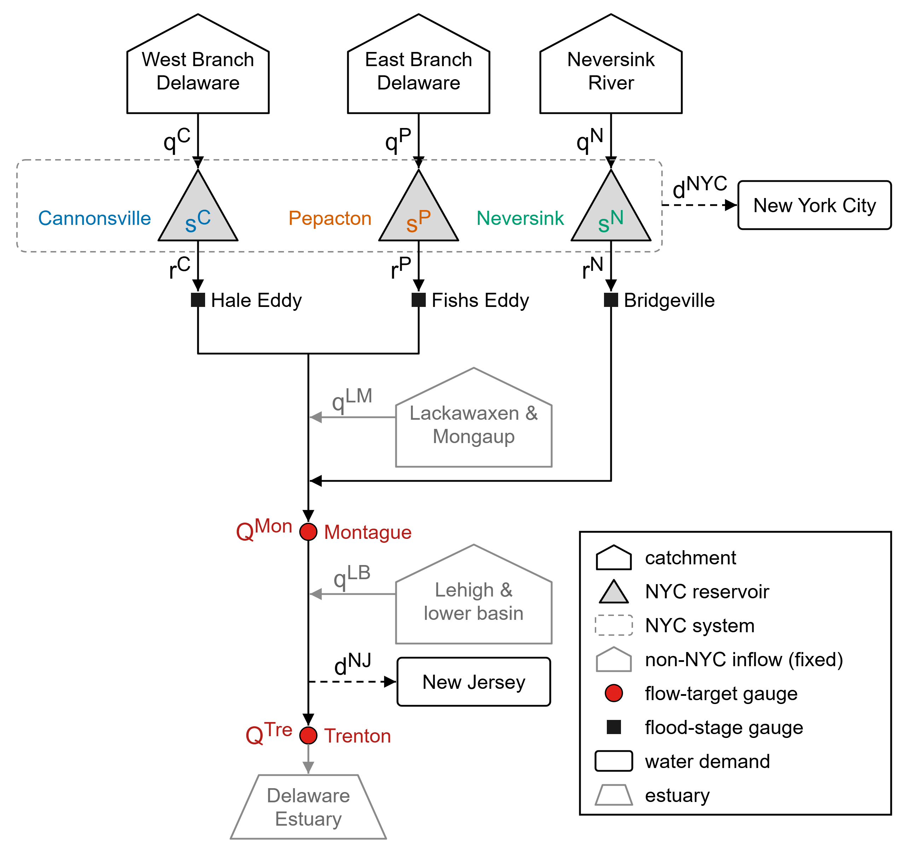
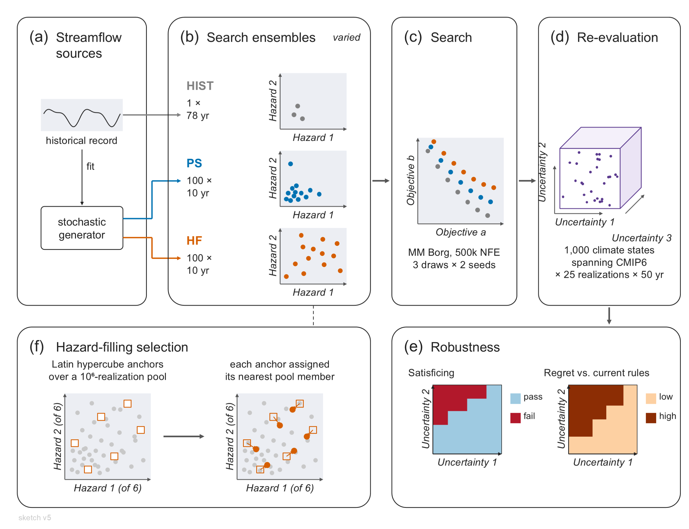
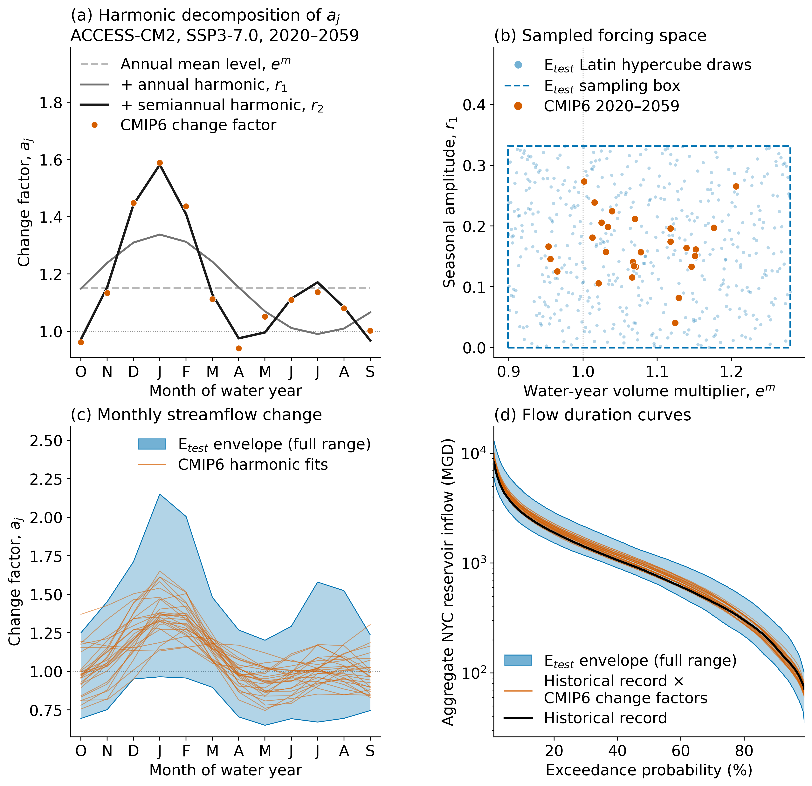
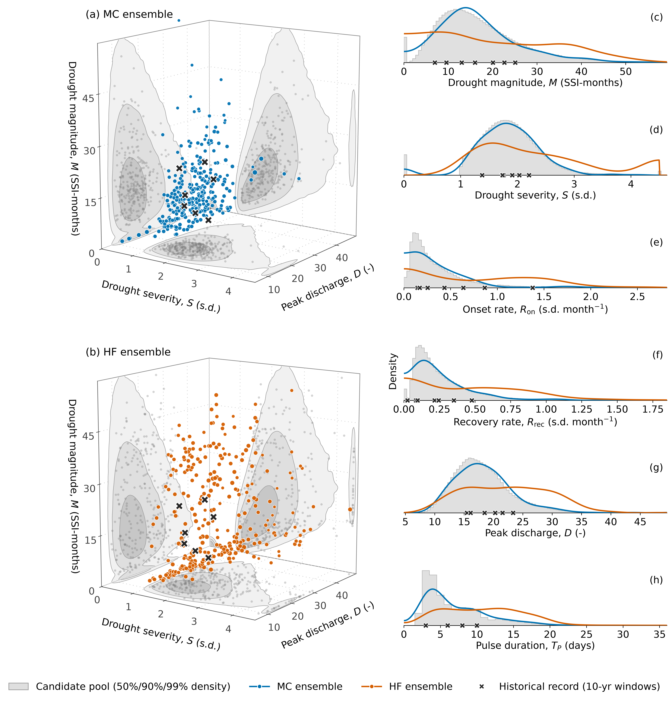
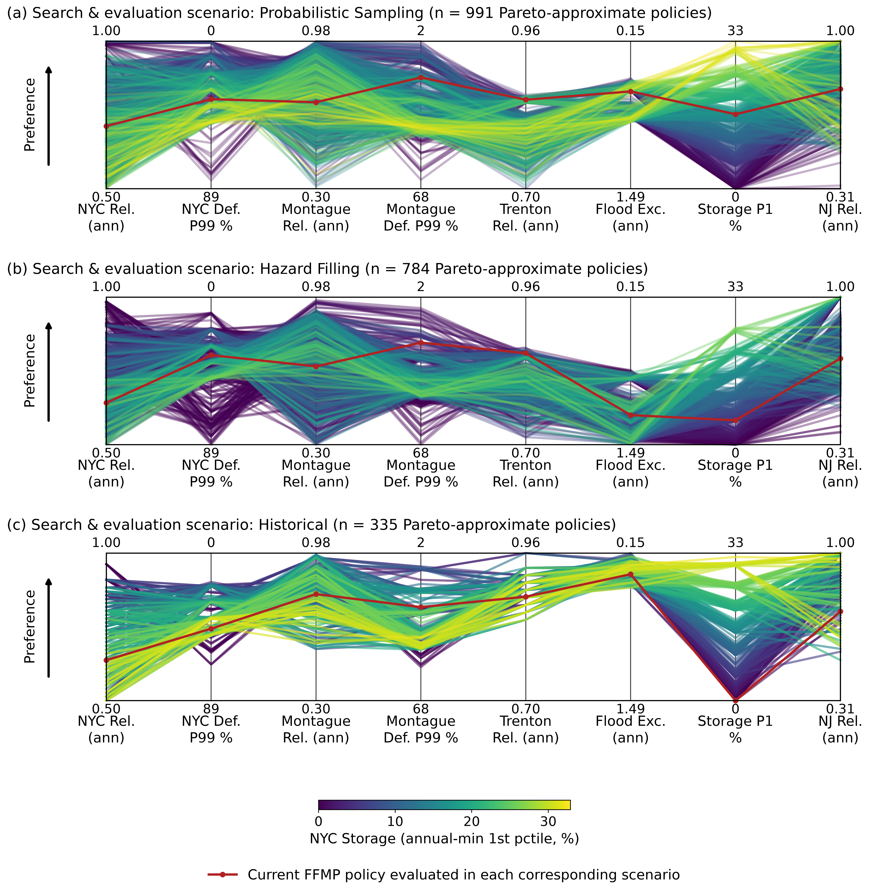
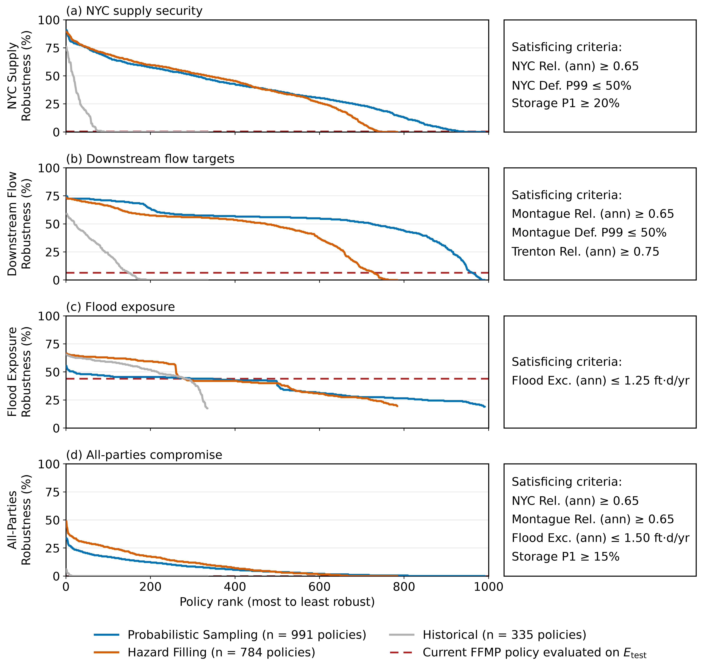
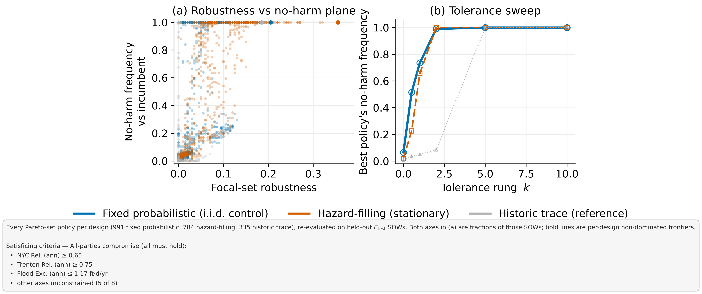
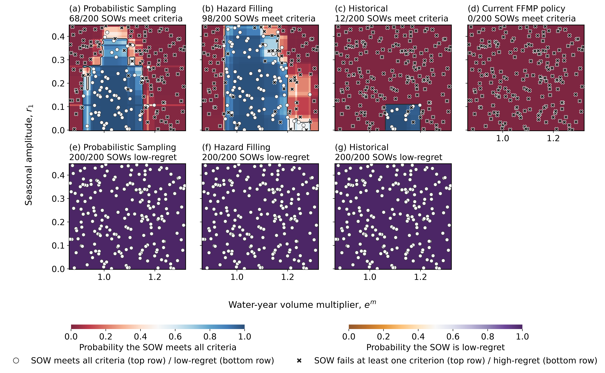

# Figure sequence plan

Contains the current plan for the manuscript figure sequence.

Currently, I am exploring two alternative manuscript outcomes:
1. Option 1: A single paper containing the full HIST, HF, and MC optimization & robustness comparison
2. Option 2: Two separate papers: HIST-only NYC-focused manuscript + HF method manuscript

Regardless of the option being used, the studies will share similar experimental settings present in the current repo:
- The same NYC operational optimization configuration (decision variables, objectives, etc)
- The same re-evaluation under uncertainty
- The same robustness analysis

However, Option 2 allows for 2 separate more focused studies, so that the HIST-focused paper can designate more space/figures toward understanding the NYC operational details, tradeoffs and performance potential. Additionally, if we explain all the operational detail, formulation and nuance in a HIST-focused paper, then the HF-method paper can be shorter and focus more on the scenario design contribution. Otherwise, Option 1 may require a very large paper.

Importantly the HF-method focused paper in Option 2 would follow the same figure plan as the combined paper in Option 1.  So, we need to develop two figure sequence plans:

CRITICAL:
Regardless of the option chosen, there should be a MAXIMUM of 12 figures, ideally closer to 10.  8-12 figures is an acceptable range.

Sequence 1: Single paper comparing methods

Sequence 2: HIST-optimization only study (no MC or HF optimization results)

The sections below outline the figure plans. For each figure: the panels, the data shown, and the purpose of the figure in the manuscript narrative. If there is not a clear purpose/role for the figure then it doesn't earn its spot.

## Reading this plan

**Status labels.**
- *Rendered*: a file exists and is embedded below. Every rendered results figure (ensemble composition onward) was produced before 2026-11-04 from superseded sets and carries retired labels ("Probabilistic Sampling", N = 100, 200 SOWs). They show layout only; no number in them is a finding.
- *Deck draft*: the image exists only inside a rough-draft deck (`docs/NYCOptimization_figure_sequence_rough_draft_{HF,HIST}.pptx`); the slide is cited.
- *Builder*: a plotting function exists in `src/plotting/` but nothing is rendered.
- *New*: nothing exists.

**The two sequences side by side.** Both land at 10 figures.

| # | Sequence 1 (combined / HF paper) | Sequence 2 (HIST paper) |
|---|---|---|
| 1 | Motivation for hazard filling | DRB system |
| 2 | DRB system and FFMP rules | FFMP rules and decision levers |
| 3 | Experimental overview | Experimental overview (HIST only) |
| 4 | Deeply uncertain forcing space | Deeply uncertain forcing space |
| 5 | Realized search-ensemble composition | Pareto set against current FFMP |
| 6 | Pareto sets per design | Which rules change |
| 7 | Robustness rankings by criterion set | Dynamics in the drought of record |
| 8 | Robustness against regret | Robustness of the re-optimized set |
| 9 | Where in the DU space | Regret and gain against FFMP |
| 10 | What the designs' policies do differently | Where the gains hold |

**What Option 2 changes.**
- The two papers repeat three setup figures (system, overview, forcing space). The HF paper can drop the FFMP-rules panel of its Figure 2 and cite the HIST paper, which shortens its test-case section more than its figure count.
- Sequence 1's Figure 10 and the RQ1 half of Figure 6 are the operational content that the HIST paper would carry in full (its Figures 5 to 7). Under Option 2 the HF paper keeps them only as a design contrast.
- Under Option 1 the operational story gets one and a half figures. Under Option 2 it gets three, plus three on whether historically optimized gains survive deep uncertainty, which is also the motivation for the HF paper.

**Pattern in the literature** (figure captions read from the Zotero PDFs; SI contents not checked). Comparable WRR/EMS/AWR papers run 8 to 10 figures, of which 2 to 4 are conceptual. The usual order is system, design schematic, ensemble characterization, parallel-axis trade-offs, out-of-sample robustness, selected policies (decision variables, then trajectories), scenario discovery. Method-comparison papers (Trindade et al. 2017; Cohen et al. 2021; Zaniolo et al. 2023) put their weight on the robustness comparison and one figure on how the resulting policies differ. System papers with an incumbent rule (Giuliani et al. 2014; Quinn et al. 2019; Herman et al. 2014) put theirs on the incumbent, the selected policies' rules and trajectories, and scenario discovery. None shows MOEA convergence in the main text.

---

## Sequence 1: Single paper comparing methods (HF-focused paper)

Narrative: the search ensemble is a design choice (1); the system and the experiment (2 to 4); the designs differ as intended (5); each finds trade-offs and improvements on its own ensemble (6); on a common held-out ensemble the designs differ in robustness (7), in regret against current operations (8), in where they succeed (9), and in the rules they produce (10).

### Figure 1. Motivation for hazard filling

- **Panels.** (a) A two-axis hazard space (one drought axis, one flood axis) with the generator's density as contours and an i.i.d. sample on top: members cluster in the common centre and the severe corners are nearly empty. (b) The same space with a hazard-filling sample: members spread over the full range. (c) Policy performance against hazard severity for a few policies: they are indistinguishable in benign conditions and separate in severe ones, so the members that discriminate between policies are the ones (a) rarely contains.
- **Data.** Schematic. Panels (a, b) may be drawn from the real candidate pool and selections on two axes; (c) stays conceptual.
- **Purpose.** States the hypothesis before any method detail: an i.i.d. search ensemble spends most of its evaluations where policies do not differ. Must stay conceptual so it does not duplicate Figure 3f (how members are selected) or Figure 5 (what was realized). Template: the side-by-side sampling schemes of Trindade et al. (2017, Fig. 2).
- **Status.** New. HF deck slide 2 is a title-only placeholder.

### Figure 2. DRB system and FFMP operating rules

 

- **Panels.** Left: network schematic of the NYC reservoirs, diversions, the Montague and Trenton flow-target gauges and the flood-stage gauges. Right: the current FFMP rules in five panels: (a) storage-zone boundaries, (b) minimum daily release, (c) diversion curtailments, (d) flow-target curtailments, (e) spill-mitigation releases. Each right-hand panel is tagged with its decision-variable group and count (Table 3).
- **Data.** Model topology; the default FFMP decision vector rendered as rules.
- **Purpose.** Orients the reader to where objectives are computed and what the 36 decision variables move. Under Option 2 the right panel moves to the HIST paper and this becomes the schematic alone.
- **Status.** Rendered, both halves (the rules file is under `outputs/`, local only). Decision-variable tags not yet drawn.

### Figure 3. Experimental overview

- **Panels.** (a) Streamflow sources, (b) the three search ensembles in hazard space, (c) search, (d) re-evaluation ensemble, (e) satisficing and regret, (f) the hazard-filling selection step.
- **Data.** Schematic.
- **Purpose.** The one figure every Methodology subsection points to; shows that only panel (b) varies between designs.
- **Status.** Rendered, stale: the embedded file is sketch v5 (labels "PS", 100 × 10 yr, 1,000 states). The current version (MC, 300 × 10 yr, 500 SOWs × 25 × 50 yr) is HIST deck slide 3.

### Figure 4. Deeply uncertain forcing space

- **Panels.** (a) Harmonic decomposition of the best-fitting CMIP6 monthly change-factor profile, (b) the sampled box over volume multiplier and seasonal amplitude with the CMIP6 fits, (c) monthly change-factor envelope of E_test against the CMIP6 fits, (d) flow duration curves of E_test against the historical record.
- **Data.** Change factors of the 27 mid-century (2020 to 2059) CMIP6 projections, the 500 E_test Latin hypercube points, E_test and historical NYC inflows.
- **Purpose.** Shows what the held-out ensemble spans and that it is wider than both the record and the mid-century CMIP6 projections.
- **Status.** Rendered for the mid-century box; panel (d) is provisional until E_test is rebuilt (`TODO.md`, rerun chain item 0b); polish pending. Open: the fourth factor (NYC entitlement utilization) is not shown. Adding one panel with the (volume, utilization) plane would cover it, since Figure 9 can use that axis.

### Figure 5. Realized composition of the search ensembles

- **Panels.** (a) MC and (b) HF members in three hazard axes over the candidate pool's density, with the historical record's 10-yr windows marked; (c to h) marginal densities of the six selection axes for MC, HF and the pool.
- **Data.** Hazard images of the candidate pool, the MC and HF search ensembles (N = 300), and the historical windows.
- **Purpose.** Method verification: the selector fills the space and MC reproduces the pool. It is the evidence base for reading any design effect, never a comparison result.
- **Status.** Rendered, stale (N and labels). Open: 3-D or 2-D scatter, the flood axis, the floor shadow.

### Figure 6. Pareto-approximate sets per design

- **Panels.** One parallel-axis panel per design, eight objectives each, lines coloured by one objective, with the current FFMP policy evaluated on that design's own ensemble. To add: the subset that dominates FFMP drawn separately.
- **Data.** Search-time objective values of each design's merged reference set and its step-06 baseline.
- **Purpose.** RQ1, first part: the trade-off structure, and that every search finds policies that improve on FFMP in its own ensemble. Values are not comparable across panels.
- **Status.** Rendered, stale.

### Figure 7. Robustness rankings by criterion set

- **Panels.** Four panels, one per criterion set (NYC supply security, downstream flow targets, flood exposure, all-parties compromise). Each shows every design's policies sorted by E_test satisficing fraction, the current FFMP policy as a reference line, and the criteria in a side box. To add: each seed as a thin line under the merged curve, so the design gap reads against seed variability.
- **Data.** Criteria scorecards from the 500-SOW re-evaluation cubes.
- **Purpose.** RQ2 headline: whether hazard filling changes robustness, and for which party. Template: the rank-ordered robustness by design of Trindade et al. (2017, Fig. 5).
- **Status.** Rendered, stale. Annotations sit below the 12 pt floor.

### Figure 8. Robustness against regret

- **Panels.** Every re-evaluated policy as a point: all-parties robustness (x) against regret frequency relative to current FFMP (y), coloured by design, with marginal densities and each design's best policy marked.
- **Data.** Criteria scorecards and the regret tables.
- **Purpose.** RQ1 headline and the central hypothesis on one plane: whether robustness is gained without paying for it in regret against current operations.
- **Status.** Rendered, stale.

### Figure 9. Where in the deeply uncertain space the designs differ

- **Panels.** Top row: probability that a SOW meets all criteria over volume multiplier and seasonal amplitude, for each design's most robust policy and for current FFMP. Bottom row: regret against FFMP over the same plane.
- **Data.** Per-SOW pass/fail and regret labels with boosted-tree surfaces fitted over the forcing factors.
- **Purpose.** Locates the design effect: which futures the HF policies gain and which no policy attains. Template: the factor maps of Quinn et al. (2018, Figs. 7 to 9).
- **Status.** Rendered, stale. The bottom row is uniform at the adopted tolerance. Replace it with the per-SOW share of each design's whole front that stays low-regret (`regret_exposure`, the registry's recommended slot-9 candidate), which settles the open slot 9 inside this figure. Consider utilization as the second axis.

### Figure 10. What the designs' policies do differently

- **Panels.** (a) Bound-normalized ranges of the 36 decision variables for each design's robust subset, grouped by rule family, with current FFMP marked. (b) The rules of each design's most robust policy against FFMP, in the Figure 2 layout.
- **Data.** Decision vectors of the re-evaluated sets.
- **Purpose.** Turns the design effect into an operational statement: which rules a hazard-filled search moves that an i.i.d. or historical search does not. In the combined paper this is also the operational content of RQ1. Templates: Cohen et al. (2021, Figs. 8 and 9); Trindade et al. (2017, Fig. 7).
- **Status.** Builder (`dv_ranges.plot_dv_ranges`, `policy_rules_compact.plot_policy_rules_grid`).

### Not in the sequence

- Candidates if a slot opens: hazard metrics illustrated on example realizations (`hazard_examples`, builder); the search-design × evaluation-ensemble transfer matrix (`transfer_evaluation_figures.py`); selected-policy dynamics in the drought of record.
- Supporting information: search convergence, generator validation, satisficing-threshold and tolerance sweeps, the demand-utilization figures.

---

## Sequence 2: HIST-focused paper

Working narrative (an assumption to confirm): the FFMP's negotiated constants can be re-tuned on the historical record to improve outcomes for several parties at once (5 to 7), and the paper then tests whether those gains hold under deep uncertainty (8 to 10). Results figures are split evenly: three on operations, three on robustness. A small set of named policies introduced in Figure 5 is carried through Figures 6 to 10.

### Figure 1. DRB system

- **Panels.** The network schematic. Optionally a basin map beside it (the Pywr-DRB map of Hamilton et al. 2024, Fig. 1, is the template).
- **Data.** Model topology.
- **Purpose.** Orients the reader to the reservoirs, the diversions, and the gauges where objectives are computed.
- **Status.** Rendered (schematic). Map panel is new.

### Figure 2. FFMP operating rules and decision levers

- **Panels.** (a) Storage-zone boundaries, (b) minimum daily release, (c) diversion curtailments, (d) flow-target curtailments, (e) spill-mitigation releases, each tagged with its decision-variable group, count and bounds.
- **Data.** The default FFMP decision vector and the search bounds.
- **Purpose.** Explains the incumbent policy and shows that the decision space is a bounded perturbation of negotiated rules. A full figure here; half a figure in Sequence 1. Templates: Kolesar and Serio (2011, Figs. 4 and 5); Quinn et al. (2019, Fig. 2).
- **Status.** Rendered (local only). Tags and bounds not yet drawn.

### Figure 3. Experimental overview

- **Panels.** Historical record to search to the re-evaluation ensemble to satisficing and regret: panels (a), (c), (d), (e) of the Sequence 1 diagram, without the three-design panel and the selection step.
- **Data.** Schematic.
- **Purpose.** Shows the two stages of the paper: optimize on the record, then test under deep uncertainty.
- **Status.** New as a HIST-only cut. The three-design diagram is HIST deck slide 3.

### Figure 4. Deeply uncertain forcing space

- **Panels, data, status.** As Sequence 1 Figure 4, including the open utilization panel.
- **Purpose.** Here it also carries the contrast with the search data: panel (d) places the historical record inside the envelope the policies are tested against.

### Figure 5. Pareto-approximate set against current FFMP

- **Panels.** (a) Parallel axes over the eight objectives: the full set in grey, the subset that dominates current FFMP in blue, FFMP in red. (b) The same axes with the named policies highlighted (one balanced policy that dominates FFMP and two contrasting policies).
- **Data.** Historical-record objective values of the HIST reference set and of the default FFMP policy.
- **Purpose.** Answers whether improvements exist within the FFMP structure and how the objectives trade off, and introduces the policies followed through the rest of the paper. Templates: Giuliani et al. (2014, Fig. 6); Quinn et al. (2019, Fig. 4).
- **Status.** Deck draft (HIST deck slides 5 to 7); builders `front_overview.plot_baseline_dominance` and `plot_selected_policies`.

### Figure 6. Which rules change

- **Panels.** (a) Bound-normalized ranges of the 36 decision variables: the full set as grey bars, the FFMP-dominating subset in colour, FFMP marked, grouped by rule family. (b) The balanced policy's rules against FFMP in the Figure 2 layout.
- **Data.** Decision vectors of the HIST reference set.
- **Purpose.** Identifies the levers that deliver the improvement and those the objectives leave unconstrained, which is the result a Decree party would read first. Templates: Herman et al. (2014, Fig. 10); Giuliani et al. (2014, Fig. 10).
- **Status.** (a) Builder (`dv_ranges.plot_dv_ranges`). (b) Deck draft (HIST deck slide 8).

### Figure 7. Dynamics in the drought of record

- **Panels.** 1961 to 1967 for FFMP and the named policies: (a) NYC aggregate storage, (b) NYC diversion and shortage, (c) Montague flow and target. Optional second column for a high-flow period if the flood trade-off is part of the story.
- **Data.** Full-model simulations of the selected policies on the historical record.
- **Purpose.** Shows the mechanism behind Figures 5 and 6 in the event that defines the system: earlier and deeper curtailment holds storage above zero. Templates: Kolesar and Serio (2011, Fig. 7); Giuliani et al. (2014, Fig. 9).
- **Status.** Deck draft (HIST deck slide 9); builder `policy_dynamics.plot_policy_dynamics`.

### Figure 8. Robustness of the re-optimized set

- **Panels.** The Sequence 1 Figure 7 layout with one set: policies sorted by E_test satisficing fraction under each of the four criterion sets, current FFMP as the reference line, the FFMP-dominating subset and the named policies marked.
- **Data.** Criteria scorecards of the HIST set and of FFMP on the 500-SOW re-evaluation.
- **Purpose.** First robustness question: whether policies that improve on FFMP over the record are also more robust than FFMP, and whether dominating FFMP on the record predicts it. Template: the history-against-stochastic re-evaluation of Giuliani et al. (2014, Fig. 7).
- **Status.** Builder (`criteria_robustness.fig_criteria_robustness`; a stale three-design render is embedded at Sequence 1 Figure 7).

### Figure 9. Regret and gain against current FFMP

- **Panels.** (a) All-parties robustness against regret frequency relative to FFMP, one point per policy (Sequence 1 Figure 8 layout). (b) Per objective, in natural units: tail regret and mean gain against FFMP in the same SOW, for the named policies.
- **Data.** Regret tables from the HIST and FFMP re-evaluation cubes.
- **Purpose.** Second robustness question: which party gains and which pays when the rules change, measured in the same future.
- **Status.** Builder (`regret_headline.fig_regret_vs_incumbent`, `regret_summary.plot_regret_decomposition`).

### Figure 10. Where the gains hold

- **Panels.** Pass/fail of the all-parties criteria over (volume multiplier, utilization) and (volume multiplier, seasonal amplitude), for FFMP and for the balanced policy, with fitted surfaces.
- **Data.** Per-SOW labels from the two cubes and the E_test forcing factors.
- **Purpose.** Third robustness question: the futures in which the re-optimized rules still satisfy every party and those in which neither policy does. It closes the paper on the limit of a historically optimized policy, which is the opening of the HF paper. Templates: Herman et al. (2014, Fig. 7); Hadjimichael et al. (2020, Fig. 7).
- **Status.** Builder (`policy_profile` failure maps, `factor_map_surfaces`).

### Not in the sequence

- Candidates if a slot opens: pairwise trade-off scatters in natural units (`tradeoff_scatter.plot_key_tradeoffs`); current FFMP's performance over the full record; each policy's historical objective value against its E_test distribution (Quinn et al. 2017, Fig. 5).
- Supporting information: search convergence, the additional policies' rules and dynamics, the 2002 drought, threshold and tolerance sweeps.
